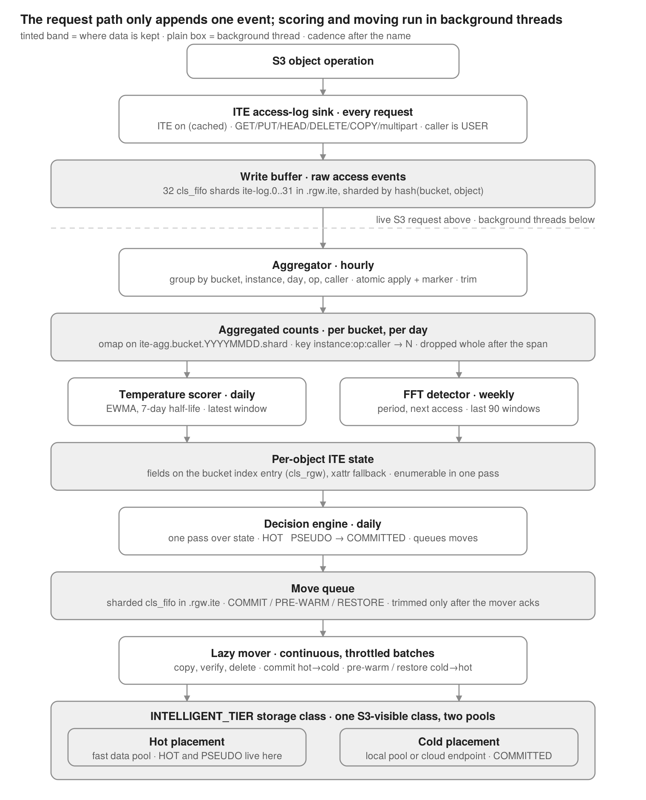
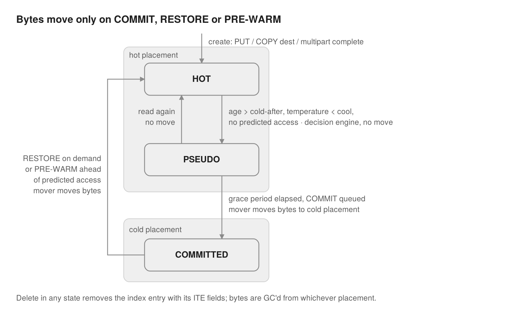
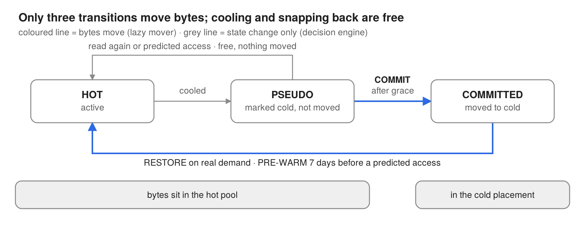

# Intelligent Tiering

This document captures the MVP design and highlights future work of Intelligent Tiering (ITE) for RGW, i.e, moving objects between a hot tier and a cold/cloud tier based on how they are actually accessed, instead of LC transition rules set by the admin. The arc is from individual objects to ML-driven groups: the MVP scores and moves each object on its own access history; the end goal (Future work) is to automatically discover which S3 objects belong together and how they behave, then tier, restore and pre-warm them as intelligent groups, with no manual tuning.

## Requirement:

- Tier objects based on actual access, not a fixed age window
- Detect periodic access (daily/weekly/quarterly) and pre-warm the object before the next expected access
- Keep hot data on the fast pool, move cold data to cheaper pool or cloud. Transparent to S3 clients, i.e, storage-class as seen by the client never changes
- Should scale to billions of objects with negligible overhead on the request path
- Beyond the MVP (see Future work):
  - Fit the knobs to the workload: named profiles per bucket or object (half-life, cold-after, pre-warm), picked by tag or by the admin
  - Learn the workload instead of configuring it: cluster objects that behave alike, suggest or apply the matching profile, with admin consent as a config option
  - Treat objects as groups: objects usually read together are tiered, restored and pre-warmed together

## Feature recap:

### Current LC capabilities/limitations:

- LC transition rules work on a fixed age per prefix/tag. No awareness of access pattern or periodicity, eg., a report read every quarter gets transitioned on day N and pays a slow read every cycle
- Scratch/write-once files sit in the hot pool for the whole LC window even if nobody reads them
- Same rule for every kind of data
- Rules need manual tuning as workloads change

### AWS S3 Intelligent-Tiering:

- Client writes with one storage-class INTELLIGENT-TIERING. Object keeps that class for life, S3 moves it between access tiers underneath
- New objects start in Frequent Access. 30 days no access -> Infrequent Access, 90 days -> Archive Instant Access. Opt-in: Archive Access (90-730 days), Deep Archive Access (180-730 days)
- GET/PUT/copy on an object in Infrequent or Archive Instant Access moves it straight back to Frequent Access. The two archive tiers need an explicit restore
- Objects < 128KB are not monitored/tiered. There is a per-object monitoring fee

### Why that is not enough:

- The shape is right (one class, service moves bytes underneath) and ITE keeps it
- The decision logic is not. It is a fixed ladder of days-since-last-access, so same blind spots as LC: no periodicity, no pre-warm, one stray access resets the object to hot, same thresholds for every workload

## Design overview:

Top to bottom: the sink is the only step on a live request. Everything below is a background thread that reads one store and writes the next.

## 1. Storage-class:

- New storage-class INTELLIGENT_TIER. Set on every object at PUT once ITE is enabled on the bucket. Never changes after that (same as AWS)
- Unlike a regular storage-class (one data pool), this one has two placements
  - hot: fast pool, eg., replicated SSD
  - cold: cheaper pool, eg., EC HDD, or a cloud-s3 endpoint
- RGW reads/writes whichever placement the object is currently in (manifest knows where the bytes are). ITE moves objects between the two in the background
- This two-placement storage-class is the only new RGW plumbing needed. Everything else reuses what is already there
- Defined at zonegroup level like any other storage-class. Each zone creates its own pools for it
- For MVP: exactly two placements with in RGW
  - Later we may add support for multiple placements., for eg., cloud-placement similar to DeepArchive in AWS S3
- LC transition rules and ITE are mutually exclusive on a bucket. Setting one where the other exists -> error.
  - LC expiration still works as-is.

## 2. Access events (access-log sink):

- New ITE sink hooked into the existing ops-log fan out (`rgw_log_op()` -> `OpsLogManifold::log()`). No new hook on the request path
- On every completed request the sink checks
  - ITE enabled on this bucket? (in-memory cache, no per-request lookup)
  - op is one of GET/PUT/HEAD/DELETE/COPY/CompleteMultipartUpload and has an object name
  - caller is USER
- If yes, appends one event {bucket id, object instance, UTC ts, op, caller} to a `cls_fifo` queue. 32 shards `ite-log.0..31` in pool `.rgw.ite`. Shard = hash(bucket, object), so all events of an object land on the same shard
  - This push is the only work ITE does on a live request
- Caller type = who caused the request
  - USER: any client identity, incl. anonymous
  - REPLICATION: multisite system user
  - LIFECYCLE / GC / TIERING: internal threads mark themselves. TIERING = ITE's own pre-warm/restore IO
  - MVP logs only USER events. Rest are dropped at the sink. Logging internal callers later is just a minor change, the field is already in the event
  - User GET that triggers a restore counts as access. Pre-warm done by ITE does not (else object looks hot because of our own prediction)
  - Replication writes never count. A replicated object starts cold in the receiving zone and warms up only on local reads
- COPY and multipart
  - CopyObject = read on the source (like GET) + write on the destination (like PUT). Destination is a new instance
  - Multipart = one event at CompleteMultipartUpload, as PUT. UploadPart is not logged, object doesn't exist yet
  - RestoreObject is not logged. The GET issued after restore is the access, and that is tracked anyway
  - LIST, bucket ops, failed requests: not logged
- Why a new log instead of reusing existing ones
  - datalog / bilog: index changes only, no reads. Trimmed once sync consumes them
  - ops log: 20+ fields, coupled to other uses
  - S3 bucket logging: lightweight mode drops reads, full mode is verbose text that needs parsing
  - ITE event: 5 fields, own retention, not affected by sync trimming

## 3. Aggregator:

- Hourly background thread on every RGW. Turns raw events into per-day counts
- Per fifo shard
  - take the per-shard lock (only one RGW works a shard at a time)
  - read events after the last committed marker
  - group in memory by (bucket, instance, day, op, caller). eg., 450 GETs on `report.pdf` on Jan 15 -> one count of 450
  - write counts into omap of `ite-agg.<bucket>.<YYYYMMDD>.<shard>`, key `instance:op:caller -> N`
  - counts + marker ("shard 7 applied upto pos P") go in one atomic omap write. Replay after a crash sees the marker and skips, so no double counting
  - trim the fifo. Raw events are kept 48h max
- Retention
  - one object per day per shard. Days older than the window (90d default, 180d max) are deleted as whole objects. No key-by-key trimming, nothing grows unbounded
  - 16 shards x 180 days = 2880 small objects per bucket, max
  - raising shard count only affects new days
- Note: instance here = object instance (name + version-id + write generation), not just the name. See section 6

## 4. Temperature scorer:

- Daily thread. Gives every object one number, 0 (cold) .. 1 (hot), for how actively it is used right now
- EWMA with a half-life (default 7 days)
  - `temperature = min(1, sum over accesses of weight * e^(-age/half_life))`
  - today's access = full weight, a week old ~1/3, a month old ~1%
- Weights: GET 1.0, PUT 0.5 (object is alive, but a write is not read pressure), HEAD 0.1, DELETE 0
  - COPY = GET on source + PUT on destination. Multipart complete = PUT
  - no per-caller weight, only USER events reach the scorer
- No history needed. Per object we keep (temperature, timestamp). Scorer decays the stored value to now, adds the latest day's weighted counts, caps at 1, writes it back
- Objects with no access still need to cool -> weekly sweep decays everything that was not touched
- We can reuse `DecayCounter`/`DecayRate` from `src/common` (MDS uses it for load balancing), with our own wall-clock timestamp
- Reads only the latest day's count objects. Candidates = objects present in that window, not a bucket scan
- Temperature is just a number. Decision engine (section 8) is what calls an object hot/lukewarm/cold
- eg., half-life 7d
  - `Ram/checkup.pdf` read 2, 10 and 20 days ago: 0.75 + 0.24 + 0.06 = 1.05 -> capped 1.0, hot
  - `scratch_dump.csv` written once 59 days ago, never read: 0.5 * 0.0002 ~ 0, cold

## 5. FFT periodic detector:

- Temperature alone can't tell a quarterly report from a dead scratch file, both are cold most of the time. FFT finds the repeat cycle so we can pre-warm before the next read instead of after
- Weekly thread (a weekly/monthly cycle doesn't change day to day)
- For each object with > 3 accesses in the span
  - build daily count series over the last 90 days (span, per-bucket config)
  - run radix-2 FFT, pick the strongest frequency above confidence 0.5
  - trust the period only if >= 3 full cycles fit inside the span
  - predicted next access = last access + period. Stored with the object
  - no clear peak -> aperiodic, temperature only
- Span is the main knob. Longest detectable period = span / 3
  - 30d -> daily, weekly. 90d -> upto monthly. 180d -> ~2 months. Quarterly reports need 270d+
  - default 90d keeps the count store small
- No FFT in ceph tree. Small self-contained radix-2 routine, input is a few hundred numbers per object
- Reads the day objects in order and builds every object's series in one pass. No per-object lookup, no extra index

## 6. ITE state, object lifecycle and evaluation:

### Per-object state:

- Fields: temperature + ts, FFT (periodic flag, period, next access, confidence), tier state (HOT/PSEUDO/COMMITTED) + time entered PSEUDO, commit count, restore count, generation
- MVP: stored on the bucket index entry (cls_rgw change). Not in S3 tags or user metadata. Visible only to admin via radosgw-admin
  - why index entry: scorers and decision engine are batch jobs that need to look at every object cheaply. Bucket listing already does that
- State belongs to the data instance (name + version-id + write generation), not to the name
  - reshard, ACL/tag update, ITE's own move -> same instance, state carried through
  - overwrite, new version, replication write with new content -> new instance, starts cold
  - discriminator = the write generation: a small integer in the ITE block, bumped on data writes only, carried forward in the cls op, also written as a head-object xattr so GET/HEAD see it (section 6). Not the ID tag (`RGW_ATTR_ID_TAG`, opaque and unordered) and not `ver.epoch` alone, which also moves on metadata rewrites

### Object lifecycle:

HOT and PSEUDO keep bytes in the hot placement; only the three mover transitions (COMMIT, RESTORE, PRE-WARM) move bytes.

- Create (PUT / COPY dest / multipart complete): class INTELLIGENT_TIER, bytes in hot placement, state HOT, generation 0, no history. Nothing moves for the first 30 days (cold-after) anyway
- Move to cold: age > cold-after, temperature < cool (0.1), no predicted access -> PSEUDO. Stays cold through grace (~half-life) -> COMMIT queued -> mover moves bytes -> COMMITTED
- Overwrite, unversioned bucket: new PUT rewrites the index entry with a fresh ITE block (generation +1 carried forward) -> starts HOT. Temperature and tier state start empty for the new generation; FFT keeps summing counts across generations of the name, so a rewrite cycle is still seen. Old bytes freed by normal RGW GC, nothing new there. Old counts stay under the old generation and age out with retention
- Overwrite, versioned bucket: previous version is its own instance, scored and tiered on its own. Old version nobody reads goes cold while current stays hot. FFT sums across version-ids of the name the same way it sums across generations, so a report re-uploaded as new versions still shows its cycle
- Delete: index entry removed -> ITE fields gone with it, nothing to clean up. Bytes GC'ed from whichever placement. DELETE event has weight 0, logged for audit only
  - versioned bucket: DELETE without version-id = delete marker only. Data, state, placement untouched. DELETE with version-id removes that instance
  - pending COMMIT/PRE-WARM/RESTORE for a deleted or overwritten instance: mover re-reads the index entry before moving, sees a different generation and silently drops it

### How objects are evaluated:

- Option A (MVP): decision engine walks the whole bucket index once a day, one sequential pass. Simple, stateless, reuses the listing. Cost grows linearly with object count, most entries are read only to be held
- Option B: due-date scheduling. An alternative design. Each evaluation computes the first day the object could change tier (cold-after expiry, grace expiry, predicted access minus pre-warm lead) and writes a schedule entry for that day. Engine visits only due objects, plus anything re-accessed since (re-scheduled early). Daily cost scales with due objects, not total object count. Needs a time-bucketed schedule store and a reconciler for crashes. Similar to what proposed in <https://docs.google.com/document/d/15fpVLhBAfRi1gCTaTTG0tGm7eZKBtyHJn92qDIKGTOE/edit?tab=t.0>
- Option C: Using S3 inventory to track these objects?
  - What it is: a periodic inventory job lists the bucket once (key, instance id, size, mtime, storage class, ITE fields) into a report object, on the S3 Inventory model (daily or weekly, CSV/ORC/Parquet plus a manifest). The decision engine reads the latest report instead of the live bucket index
  - What it buys: scoring is decoupled from the live index, which is read once by the inventory job rather than held through the engine's pass. The report is a plain object other consumers can use: admin reporting, offline analysis, the test plan's hot/cold split check. AWS Inventory already carries a per-object Intelligent-Tiering access tier field, so admin-visible tier state could ride the same report
  - What it costs: still a full bucket walk per run, so cost grows with object count as in Option A; the walk moves, it does not go away. The report is a second copy of per-object state, stale by up to one inventory period, so a decision taken from it must be checked against the live index entry before acting (the mover's re-read before moving is that check). Depends on an inventory feature in RGW; without one, ITE writes its own generator, which is Option A plus a write step
  - Where it fits: not a replacement scoring loop on its own, but a good source for the brown-field initial scan, for admin reporting, and for seeding Option B's schedule store once, after which B keeps it current
  - Open: whether RGW has an inventory job today or ITE adds one; inventory cadence against cold-after and grace; where report objects live (.rgw.ite vs a user-visible destination bucket) and who may read them
- Open. See open items at the end

### Overwrites:

- Must happen on any data write
  - tier state -> HOT (bytes landed in hot)
  - pending moves for the old content dropped (mover compares generation)
- Why the generation design: files regenerated in place under the same name, eg., report rewritten monthly and read weekly. With reset the FFT never sees enough cycles, no pre-warm, temperature drops to PUT weight on every rewrite. Without reset, old heat decays at half-life anyway and cold-after protects new content for 30 days either way

* Recommendation: a per-object generation number. Neither full reset nor full keep, each consumer picks what it reads
  - One small integer in the ITE block, bumped on every data write (PUT, COPY dest, multipart complete) and carried forward in the cls op: read the old value, write +1. Metadata rewrites, reshards and ITE's own moves leave it alone
  - Also written as a head-object xattr at PUT, so the access-log sink sees it on GET/HEAD without reading the index entry
  - Every access event carries it inside the instance (name + version-id + generation), so aggregated counts are keyed per generation
  - Temperature, tier state, commit/restore counts and the mover's stale-move check read the current generation only: an overwrite still lands in HOT with an empty history (temperature restarts from the PUT weight) and pending moves for old content still drop
  - FFT, and anything else that wants the long pattern, sums counts across all generations of the name: a report rewritten monthly and read weekly shows its cycles and pre-warm works
  - To settle: delete then recreate restarts at generation 0, so either the aggregator drops a name's counts on DELETE (it already sees the event) or the generation seeds from the create time; versioned buckets give each version its own instance, FFT sums across version-ids the same way; whether the mover also compares the ID tag as a second guard

## 7. Lazy mover:

- The only component that moves bytes. Background, throttled batches, never on a client request. Same style as LC/GC/Restore worker threads
- Decision engine pushes actions to a sharded move queue (`cls_fifo` in `.rgw.ite`). Mover runs on every RGW, drains the queue under a per-shard lock, acks an action only once the bytes are durably in place. Queue is trimmed only after ack, never on a timer
- Before each move: re-read the object's index entry. If the instance was deleted or overwritten since the action was queued -> skip silently, not an error
- A move = change of placement + tier state flip. Storage-class never changes, so nothing is visible to the S3 client
- Every move is copy -> verify -> delete source. A crash leaves at worst an orphan copy to clean, never lost data
- Reuses existing paths
  - COMMIT: same transition path used today for storage-class / cloud transition
  - RESTORE / PRE-WARM: existing cloud-tier restore (`rgw_cloud_tier_restore_object`), i.e, the Glacier style restore that writes the object back into the cluster
  - cold placement (pool or cloud-s3) is assumed configured before ITE is enabled. ITE only moves objects in and out of it
- Only byte move a live request can cause: read-through restore of an object on a cloud placement. Existing path

### Tiering states:

- HOT: active, bytes in hot placement
- PSEUDO: marked as cold candidate, bytes NOT moved. Grace period derived from half-life. Read again here -> back to HOT for free. Pre-warmed objects land here too
- COMMITTED: confirmed cold, bytes moved to cold placement
- Invariant: HOT and PSEUDO = bytes in hot pool. COMMITTED = bytes in cold. So only three transitions move bytes, and those are the mover's whole job
  - COMMIT: PSEUDO -> COMMITTED (hot -> cold)
  - PRE-WARM: COMMITTED -> hot, ahead of a predicted access
  - RESTORE: COMMITTED -> hot, on real demand
- Who writes state
  - decision engine owns the two free transitions (HOT <-> PSEUDO)
  - mover owns the three byte moves. Writes COMMITTED only after bytes are in cold. Bumps commit/restore counts
- COMMITTED object on a local cold pool: reads served in place and feed temperature. Promoted back to HOT only when temperature crosses warm (sustained reads), one stray read won't bounce it
- COMMITTED object on a cloud endpoint: first read can't be served in place -> restores at once

## 8. Decision engine:

- Daily thread. Input: temperature, FFT prediction, current state. Output: one action per object
- Writes the two free state changes itself. Queues everything else for the mover. Never moves data
- One set of bucket-level knobs for all objects

| Knob | Default | Meaning |
| --- | --- | --- |
| half-life | 7 days | how fast temperature fades (section 4). Also sets PSEUDO grace period |
| warm threshold | 0.3 | above this the object is hot |
| cool threshold | 0.1 | between warm and cool = lukewarm, hold |
| cold-after | 30 days | min age before an object can be demoted. Residency floor, not a trigger |
| max-age backstop | off | optional. Past this age, demote regardless of temperature |
| pre-warm | on, 7 day lead | restore a periodic object this many days before predicted access |
| min tier size | 4 KiB | smaller objects are never tiered, move costs more than it saves |
| FFT confidence | 0.5 | min peak strength to trust a period |
| FFT span | 90 days | history window for the detector (section 5) |

- Rules, in order checked
  1. size < min tier size -> skip
  2. age < cold-after -> hold
  3. max-age set and exceeded -> demote regardless
  4. temperature > warm -> hold. If COMMITTED and back above warm -> promote
  5. FFT predicts access within pre-warm lead and pre-warm on -> queue PRE-WARM
  6. temperature > cool -> hold (lukewarm)
  7. already PSEUDO and cold for longer than grace -> queue COMMIT
  8. else -> mark PSEUDO
- Temperature is the primary signal. cold-after and max-age only bound it from either side
- RESTORE is not produced by the daily pass. It is queued when a COMMITTED object on cloud is actually read

## 9. Example:

- Bucket `hospital-records`, ITE enabled with defaults. FFT span set to 270d since it holds quarterly reports
- Day 0: upload `patients/Ram/checkup.pdf`, `reports/quarterly_q1.pdf`, `exports/scratch_dump.csv`. All three get INTELLIGENT_TIER, land in hot pool, state HOT, no history
- Days 1-30
  - doctor opens `checkup.pdf` every day. analyst reads `quarterly_q1.pdf` heavily in week 1 then stops. nobody opens `scratch_dump.csv`
  - each read -> USER event via the sink. nightly LC scan and sync to the second zone are LIFECYCLE/REPLICATION, dropped
  - hourly aggregator folds events into that day's count objects
  - nightly scorer: `checkup.pdf` ~1.0, `quarterly_q1.pdf` decays to ~0.05 by day 30, `scratch_dump.csv` ~0
  - decision engine holds all three, none is past cold-after yet
- Day 31
  - `checkup.pdf` > warm -> hold
  - `scratch_dump.csv` < cool, no prediction -> PSEUDO. nothing moves
  - `quarterly_q1.pdf` just under cool -> PSEUDO
- Days 38-40
  - both PSEUDO objects stayed cold through grace (~1 week) -> COMMIT queued
  - mover copies to cold placement, verifies, deletes hot copy, then writes COMMITTED
  - `s3api list-objects` still shows INTELLIGENT_TIER on everything
- Day 90: quarter end, analyst reads `quarterly_q1.pdf` again
  - cold = local pool: read served from there, feeds temperature. after a few reads temperature > warm -> promoted back to hot
  - cold = cloud endpoint: first read triggers read-through RESTORE at once. the read counts, a user caused it
  - either way object is HOT for the burst, cools after, committed again ~day 130
- Day 270: weekly FFT sees three quarter-end bursts in the span, trusts a 90d period, predicted next access = day 360
  - day 353: PRE-WARM queued (7 day lead). mover brings it to hot. the pre-warm is TIERING, doesn't count as access
  - day 360: analyst's read is served hot
  - `scratch_dump.csv` has no pattern, stays COMMITTED
- Day 400: doctor uploads a new `checkup.pdf`. New instance, starts with no history even though the old one was hot. Next day's reads warm it up again

## 10. Multisite / replication:

- Objects in an ITE bucket replicate between zones exactly as today. **ITE state does NOT replicate**
- ITE runs per zone (like AWS Intelligent-Tiering decides per region). Each zone has its own fifo, count store, per-object state and worker threads. Scores on the access it sees locally
- Same object can be hot in one zone and cold in another. That is intended. A zone saves fast storage by cooling data its own users never read
- Why it stays consistent with no cross-zone sync
  - storage-class is set once at PUT and replicated with the object. No tiering action ever rewrites it -> every zone shows INTELLIGENT_TIER regardless of where each zone put the bytes
  - replication writes are tagged REPLICATION and dropped at the sink. sync traffic never looks like demand. replicated object starts cold in the receiving zone, warms only on local reads
  - ITE fields never ride the sync stream. bilog carries index ops, not the entry payload
- Shared cloud cold endpoint: before uploading, a zone checks by ETag if the instance is already there. If yes, only drops its local hot copy. Commit is idempotent across zones
- Test plan has the two-zone scenario (same object stays hot where users read it, goes cold where nobody does)

## 11. Where it plugs into RGW:

- Storage goes through SAL. Everything ITE needs from storage is four abstract contracts in the driver interface. Workers are written once, a backend becomes ITE capable by implementing them. RADOS first, store and filter drivers get the same interfaces

| Contract | What it is |
| --- | --- |
| 1. write buffer | append-only sharded event queue. append / read after cursor / trim upto cursor |
| 2. aggregated counts | windowed counter store. idempotent apply of deltas + marker, read one window, iterate windows, drop a window |
| 3. per-object ITE state | read/write one object's fields. enumerate all objects of a bucket in one sequential pass |
| 4. move queue | append-only sharded action queue. append / read after cursor / ack upto cursor |
| 5. two-placement storage-class | one class resolves to hot + cold placement. report which one an instance is in, move it between them |

- Workers (aggregator, temperature scorer, FFT detector, decision engine, lazy mover) are background threads started at RGW boot, same as LC/GC workers
- Patterns reused
  - Restore subsystem is the template: per-zone pool, sharded `cls_fifo` queue (`neorados::cls::fifo::FIFO` as in `RadosRestore`), per-zone worker thread (`RestoreWorker`, cond var for clean shutdown)
  - EWMA decay from `src/common/DecayCounter.h` (MDS load balancing)
  - sharded day objects scale the same way the bucket index does
- Config keys

| Key | Default | Controls |
| --- | --- | --- |
| `rgw_ite_log_max_shards` | 32 | fifo shards for the write buffer |
| `rgw_ite_log_buffer_hours` | 48 | how long raw events stay in the fifo |
| `rgw_ite_log_retention_days` | 180 | how long aggregated day objects are kept |
| `rgw_ite_log_processor_period` | 3600s | aggregator interval |
| `rgw_ite_agg_object_shards` | 8 | hash shards per bucket per day window. raise for very large buckets |
| `rgw_ite_agg_window` | day | window granularity |
| `rgw_ite_shard_lock_max_time` | 300s | per-shard lock lifetime |

- Scoring/decision knobs (half-life, warm, cool, cold-after, pre-warm lead, min tier size, FFT confidence, FFT span) are bucket-level settings, listed in section 8

## 12. Admin CLI:

- Driven through `radosgw-admin` subcommands. Same operations exposed over AdminOps REST API.

| Operation | Example |
| --- | --- |
| enable ITE on a bucket | `radosgw-admin bucket tiering enable --bucket=hospital-records` |
| show bucket ITE config and knobs | `radosgw-admin bucket tiering get --bucket=hospital-records` |
| set a knob on a bucket | `radosgw-admin bucket tiering set --bucket=hospital-records --fft-span=270` |
| disable ITE on a bucket (config preserved, see note) | `radosgw-admin bucket tiering disable --bucket=hospital-records` |
| view ITE state of an object or bucket | `radosgw-admin ite state ...` |

- ITE state (temperature, tier state, FFT prediction) is admin-only in the MVP. Not exposed to end users over S3
- Config is per bucket. Global default for new buckets is future work
- Note: MVP focuses on green-field buckets. Once ITE is enabled it stays enabled, a working disable is a stretch item. The disable command above keeps the bucket's thresholds for re-enable
- Knobs per bucket = section 8 table
- LC transition rule and ITE can't both be set on a bucket. LC expiration can

## 13. Test plan:

- Setup: vstart cluster, 3 RGW instances, BlueStore, cold storage-class pre-configured. Driven with aws cli, radosgw-admin and a small history injection tool
- Unit tests , performance, security, regression
- Acceptance scenarios

| # | Question | Check |
| --- | --- | --- |
| 1 | user activity vs internal noise? | user GET records an access. replication write and GC run are ignored |
| 2 | cold data moves on its own? | untouched 30 days -> PSEUDO. cold through grace -> moved to cold placement |
| 3 | repeating patterns learnt? | file read every 90 days is detected. pre-warmed 7 days before, served hot on the day |
| 4 | file comes back on demand? | committed object restored on read, stays hot while it keeps being read |
| 5 | each zone decides on its own? | same object stays hot where users read it, cold where nobody does |
| 6 | crash mid-move safe? | copy, verify, delete. crash before verify leaves original intact, move retries |
| 7 | scale leaves user requests alone? | one small append per request. analysis runs hourly/daily/weekly in background |
| 8 | overwrite resets history? | new upload of same key starts cold. old history not inherited (see section 6, may flip) |
| 9 | tiny / young files protected? | < 4 KiB or < 30 days old: never tiered |
| 10 | visible class ever changes? | S3 always returns INTELLIGENT_TIER while bytes move |

- enable on fresh bucket -> upload -> access -> wait through schedules -> inspect state -> disable/re-enable
- Regression pass compares request latency and throughput against a pre-ITE baseline

## 14. Cost / scale evaluation:

- How: vstart cluster with 3 RGWs and a pre-configured cold storage-class, driven by synthetic workloads (steady, bursty, daily/weekly/quarterly periodic, write-once). Then a scale run at tens of millions of objects to check that overhead grows linearly with object count
- Could refer to testing done as part of <https://docs.google.com/document/d/15fpVLhBAfRi1gCTaTTG0tGm7eZKBtyHJn92qDIKGTOE/edit?tab=t.0>

## Open items:

- Evaluation and state store: Option A, state on the bucket index entry with a daily full walk, or Option B, separate name-keyed state store with due-date scheduling. B removes the cls_rgw change and the daily walk, no longer differs on overwrite history (the generation number covers that in both), needs event-driven cleanup plus a reconciler for deletes (section 6). Choosing B reopens the index-entry decision above

## MVP0 Scope:

- Fresh deployments only. ITE is enabled on new (green-field) buckets before data lands. Buckets with existing data are not handled
- Exactly two storage placements under INTELLIGENT_TIER: one hot pool, one cold placement (pool or cloud-s3 endpoint). No chain of more than two
- One flat set of bucket-level knobs for every object. No workload profiles, no clustering, no per-object policy
- Once ITE is enabled on a bucket it stays enabled. Disable is a stretch item
- Enabled only through radosgw-admin / AdminOps, not through an LC rule
- Only USER events are logged. Internal callers (LC, GC, replication, ITE's own moves) are dropped at the sink
- Event set is GET/PUT/HEAD/DELETE/COPY/CompleteMultipartUpload. Nothing else
- Multisite: per-zone decisions, nothing replicated apart from the object itself
- Evaluation is the daily full walk of the bucket index (Option A). Due-date scheduling is an open alternative, not in scope unless decided
- Numbers (cost, scale) are measured on the MVP, not claimed up front

## MVP1/Later Scope:

Details for each of these will be followed up later. Listed here only so the boundary of the MVP is clear.

### Brown-field buckets:

- Enabling ITE on a bucket that already has data. Needs a one-time pass to set the class/placement on existing objects and seed their state

### More than two placements:

- MVP gives INTELLIGENT_TIER exactly two placements. Natural follow-on is an ordered chain under the same class, eg., hot (replicated SSD) -> cold (EC HDD) -> archive (cloud). S3 clients still see one class
- Ordered chain under the same INTELLIGENT_TIER class, eg., hot (SSD) -> cold (EC HDD) -> archive. Archive could be a cloud placement using the existing cloud-tier, eg., S3 Glacier Deep Archive, with restore via the cloud-tier restore path
- Tier state becomes placement index + pending flag. Each boundary gets its own thresholds and residency floor
- What changes
  - storage-class definition becomes an ordered list of placements instead of a pair
  - tier state becomes index of current placement + pending flag, instead of HOT/PSEUDO/COMMITTED. PSEUDO grace applies at every boundary
  - each boundary gets its own demotion rule. hot->cold keeps today's warm/cool + cold-after. cold->archive adds a lower temperature threshold and a longer residency floor in cold, so an object must be quiet a long time before paying the archive round trip
  - decision engine moves one step at a time going down, never skips a placement. Promotion goes straight back to hot in one move
  - mover needs nothing new. commit is already "one step colder", restore/pre-warm already "move to hot"
  - profiles carry per-boundary knobs. admin CLI lists the chain per bucket

### Quotas:

- Hot-tier capacity budgets and quota enforcement: a ceiling on bytes in the hot placement per bucket or user. Under pressure the decision engine commits the coldest PSEUDO objects before their grace runs out, and holds pre-warms once the budget is full

### Enable ITE via LC rules:

- Enable ITE through an LC rule: a lifecycle transition to INTELLIGENT_TIER (the AWS way) turns ITE on for the matching prefix or tags, alongside the radosgw-admin enable command

### Other deferred items:

- Global ITE default for new buckets: a zone-level setting so every new bucket starts with ITE on and the default thresholds, instead of enabling bucket by bucket
- Disable ITE on a bucket: stop scoring and moves and leave objects where they are, with a restore-all-to-hot option. Thresholds are kept so re-enable picks up where it left off
- Logging internal callers with zero scoring weight (audit, pre-warm hit rate): events from LC, replication and ITE's own mover are logged but do not heat the object, so pre-warm hits can be measured. The caller field is already in the event
- Additional S3 ops as events: UploadPartCopy, s3select, POST Object, append, range GETs, batch DeleteObjects, metadata ops. Each needs a weight and a call on whether it is a data write (generation bump) or a read

## Future work (ML-driven):

The MVP applies one knob set to every object in a bucket. The items below make the knobs fit the workload: first by hand (profiles), then by learning (clustering, co-access, Markov), then by weighing cost and priority.

### Workload profiles:

- Named presets for half-life / cold-after / pre-warm (analytical, archive, streaming, content, compliance, data-lake, custom). Picked via admin command or S3 bucket tag, so a bucket gets sensible thresholds without hand-tuning each knob
  - Profile = named preset for half-life, cold-after and whether pre-warm is honoured. PSEUDO grace follows the profile's half-life
  - Six built in. Custom profiles via radosgw-admin / AdminOps from day one

| Profile | Half-life | Cold after | Pre-warm | Typical data |
| --- | --- | --- | --- | --- |
| analytical | 14d | 60d | yes | quarterly reports, dashboards |
| archive | 3d | 7d | no | backups, scratch |
| streaming | 1d | 7d | no | IoT logs, time series |
| content | 7d | 30d | yes | media assets |
| compliance | 14d | 90d | yes | legal, regulatory |
| data-lake | 7d | 30d | yes | mixed (default) |

- Precedence: object tag > bucket tag > admin setting > default (data-lake)
- Users pick a profile with the normal S3 tagging API, RGW-namespaced key, eg., `rgw.ite.profile=compliance`. Object tags allow a per-object override inside a bucket
- Resolved profile id is stored with the other ITE fields

### Behavorial clustering:

- Groups objects that behave alike and suggests the profile that fits each group. Runs as a weekly batch over signals the scorer already has
  - Question it answers: which objects in this bucket behave alike, and does the assigned profile match reality
  - Weekly batch. Per accessed object build a small feature vector from signals we already have: temperature, access frequency/recency, periodicity + period, read/write ratio, age, size
    - read/write ratio is what separates write-then-cold data (logs, backups) from read-periodic data (reports, media). temperature alone can't
  - Feed into a BIRCH CF-tree persisted per bucket. One pass, low memory, no cluster count up front, incremental with stable cluster ids
  - Cosine similarity on top, compares direction not magnitude (report read 100x/week and one read 5x/week = same shape)
    - merges look-alike clusters into named archetypes, flags outliers, assigns a new/changed object to nearest archetype with one comparison, no re-run
    - feature vectors normalised to 0..1 first so no axis dominates
  - Each archetype maps to the closest profile. Outlier that fits nothing follows the bucket's regular LC policy
  - Both are compact in-daemon C++. No external ML lib, no GPU. Merge/outlier thresholds have defaults, configurable

### Co-access grouping:

- Item2Vec or co-occurrence counting so objects usually read together are restored and tiered together, instead of one restore at a time as reads arrive
  - Clustering gives look-alike objects the same policy, but each object still tiers and restores on its own: restoring one does not restore the ones usually read with it
  - A co-access model (Item2Vec session embeddings, or plain co-occurrence counting at query level) could detect those relationships: restore one, restore its siblings; keep all hot while any is active; tier all when the group goes idle
  - Analysis so far says the value is narrower than it looks. Strongly co-accessed objects share frequency and recency, so clustering groups them anyway and the only gap is auto-restore. Weakly co-accessed ones would waste restore IO and hot space if siblings were restored every time. The case narrows to objects nearly always read together but with different individual patterns, eg., a LanceDB manifest read on every query next to data fragments read only for matching partitions
  - Revisit if production clustering shows objects consistently read together landing in different clusters and causing repeated cold reads on siblings

### Priority and cost-aware decisions:

- Priority per profile, capacity pressure, a per-action cost model and yo-yo detection: an object that keeps bouncing between hot and cold gets a longer residency before its next move

### Markov chain commit predictor:

- Learned per-bucket probability of staying cold, used in place of the fixed grace period to decide when PSEUDO becomes COMMITTED
  - Today: commit once PSEUDO for longer than the fixed grace period
  - A per-bucket transition matrix over the three states, trained by counting state transitions across the bucket's objects, answers "how likely does this object stay cold N more days given it has been cold M days". The commit rule becomes "commit when the probability of staying cold is high enough" instead of "commit after a fixed number of days"
  - Much of this is covered already: FFT handles periodic bounce-backs, per-profile cold-after differs by workload, yo-yo detection catches repeat offenders
  - Where it still adds: per-bucket learning (one bucket's archive objects bounce back far more often than another's), acting before the first wasted commit rather than after two, and removing one fixed threshold that is otherwise a guess
  - Revisit once production data shows commit patterns. If fixed thresholds cause excessive yo-yo in some buckets, this drops straight into the existing commit gate
